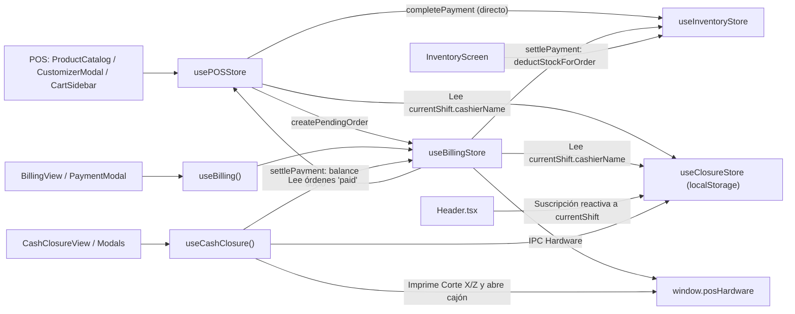
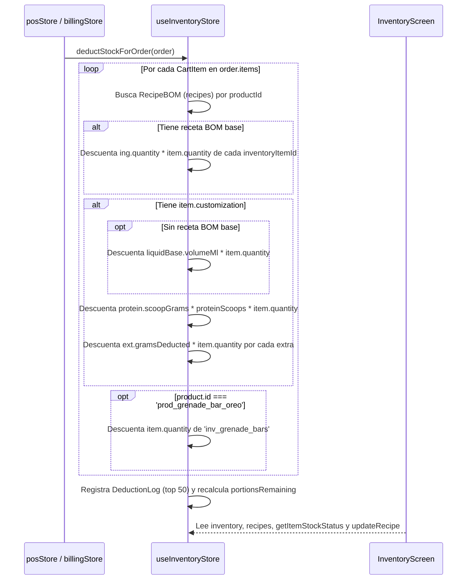

# Arquitectura Técnica — PrimeFitness Bar (`PrimeFitness POS`)

Documentación técnica integral del sistema **PrimeFitness Bar** (`primefitness-v2`), generada a partir del análisis directo del código fuente actual del repositorio.

---

## 1. Resumen del Proyecto y Stack Tecnológico Real

### Descripción General
**PrimeFitness Bar** (`productName`: `PrimeFitness POS`, `appId`: `com.primefitness.pos`, versión `1.0.0`) es una aplicación de Punto de Venta (POS) táctil diseñada para operar barras de suplementación deportiva, smoothies, jugos cold-pressed y cocina fitness en gimnasios. Funciona tanto en modo web (navegador con simuladores de hardware) como empaquetada en escritorio sobre **Electron** (Windows x64) con soporte para periféricos ESC/POS (impresoras térmicas de 80mm/58mm, impresoras de etiquetas adhesivas de 58mm×40mm y cajones portamonedas RJ11).

La interfaz principal (`src/App.tsx` y `src/components/common/Header.tsx`) articula cuatro vistas activas:
1. **Toma Comandas (`pos`)**: Catálogo categorizado, personalización de bebidas con cálculo nutricional en vivo y carrito lateral.
2. **Caja / Cobro (`billing`)**: Bandeja de comandas pendientes de pago, métricas de espera y liquidación multipago.
3. **Cierre / Arqueo (`closure`)**: Resumen financiero del turno, movimientos extraordinarios de efectivo, auditoría de ventas y emisión de Cortes X / Z.
4. **Inventario (`inventory`)**: Monitor de stock por insumos (gramos, ml, piezas, unidades) y recetario editorial con desglose Bill of Materials (**BOM**).

### Versiones Reales Detectadas en `package.json`

| Categoría | Paquete / Tecnología | Versión en `package.json` | Uso real en el proyecto |
| :--- | :--- | :--- | :--- |
| **UI Core** | `react` | `^19.2.8` | Librería de componentes e interfaces táctiles |
| **DOM Renderer** | `react-dom` | `^19.2.8` | Montaje de la SPA en `#root` (`src/main.tsx`) |
| **Lenguaje** | `typescript` | `~6.0.2` | Tipado estricto (`ES2023`, `verbatimModuleSyntax`, `erasableSyntaxOnly`) |
| **Bundler / Dev Server** | `vite` | `^8.3.0` | Servidor de desarrollo (puerto `5173`) y build de producción (`dist/`) |
| **Plugin Vite React** | `@vitejs/plugin-react` | `^6.1.1` | Compilación JSX / Fast Refresh |
| **Estilos CSS** | `tailwindcss` | `^4.3.3` | Framework CSS v4 (`@import "tailwindcss";` en `src/index.css`) |
| **Integración Tailwind** | `@tailwindcss/vite` | `^4.3.3` | Plugin oficial de Tailwind v4 para Vite |
| **Estado Global** | `zustand` | `^5.0.15` | Gestión reactiva en 4 stores de dominio (`pos`, `billing`, `closure`, `inventory`) |
| **Iconografía** | `lucide-react` | `^1.55.0` | Iconos vectoriales en toda la interfaz |
| **Runtime Escritorio** | `electron` | `^34.2.0` | Contenedor nativo de escritorio, aislamiento IPC y acceso a spooler/TCP |
| **Empaquetador** | `electron-builder` | `^25.1.8` | Generación de instalador `nsis` y binario `portable` x64 en `release/` |
| **Linter** | `oxlint` | `^1.81.0` | Linter configurado vía `.oxlintrc.json` (`react`, `typescript`, `oxc`) |
| **Tipos** | `@types/node`, `@types/react`, `@types/react-dom` | `^24.13.3`, `^19.2.18`, `^19.2.7` | Definiciones de tipos para Node, React y DOM |
| **Orquestación Dev** | `concurrently`, `cross-env`, `wait-on` | `^9.1.2`, `^7.0.3`, `^8.0.2` | Arranque simultáneo de Vite y Electron esperando `tcp:5173` |

> **Nota sobre Base de Datos / Persistencia:** No existe dependencia de SQLite ni ORM instalada en `package.json`. La persistencia en cliente se realiza mediante Zustand en memoria y `localStorage` para el módulo de cierre (`pf_active_cash_shift`, `pf_cash_closures_history`, `pf_active_denominations`, `pf_active_cash_movements`) y selección de impresoras (`pos_printer_receipt`, `pos_printer_label`). En `closureStore.ts` el bloqueo en SQLite y la cola de sincronización central están simulados mediante estructuras logueadas en consola e historial local.

### Scripts Disponibles en `package.json`

| Script | Comando exacto | Propósito |
| :--- | :--- | :--- |
| `dev` | `vite --host` | Inicia el servidor web de desarrollo en `http://localhost:5173` y lo expone en la red Wi-Fi local (`--host`). |
| `build` | `tsc -b && vite build` | Ejecuta validación de tipos (`tsconfig.json` con referencias a `app` y `node`) y compila a `dist/` con `base: './'`. |
| `lint` | `oxlint` | Ejecuta el análisis estático con `oxlint` usando las reglas de `.oxlintrc.json`. |
| `preview` | `vite preview --host` | Sirve localmente el bundle compilado en `dist/` y lo expone en la red local (`--host`). |
| `electron:dev` | `concurrently -k "cross-env NODE_ENV=development vite" "wait-on tcp:5173 && cross-env NODE_ENV=development electron ."` | Levanta Vite y espera a que el puerto `5173` responda para iniciar Electron (`electron/main.cjs`) con DevTools desacopladas. |
| `electron:build:win` | `npm run build && electron-builder --win --x64` | Compila el frontend y empaqueta el instalador NSIS y la versión portable Windows x64 en `release/`. |

---

## 2. Árbol de Directorios y Mapa de Archivos

Estructura completa del repositorio omitiendo `node_modules/` y `dist/`:

```text
prime-fitness-bar/
├── .gitignore
├── .oxlintrc.json
├── index.html
├── package.json
├── package-lock.json
├── README.md
├── tsconfig.json
├── tsconfig.app.json
├── tsconfig.node.json
├── vite.config.ts
├── electron/
│   ├── main.cjs
│   ├── preload.cjs
│   └── hardware/
│       ├── cashDrawerService.cjs
│       └── printerService.cjs
├── public/
│   ├── favicon.svg
│   └── icons.svg
└── src/
    ├── App.css
    ├── App.tsx
    ├── index.css
    ├── main.tsx
    ├── assets/
    │   ├── hero.png
    │   ├── react.svg
    │   └── vite.svg
    ├── components/
    │   ├── billing/
    │   │   ├── BillingView.tsx
    │   │   └── PaymentModal.tsx
    │   ├── closure/
    │   │   ├── CashClosureView.tsx
    │   │   ├── CashMovementModal.tsx
    │   │   ├── ClosureReceiptModal.tsx
    │   │   ├── ConfirmCloseModal.tsx
    │   │   └── OpenShiftModal.tsx
    │   ├── common/
    │   │   ├── Header.tsx
    │   │   └── Toast.tsx
    │   ├── inventory/
    │   │   └── InventoryScreen.tsx
    │   ├── label/
    │   │   ├── PrintSimulatorModal.tsx
    │   │   └── StickerLabelPreview.tsx
    │   └── pos/
    │       ├── CartSidebar.tsx
    │       ├── CategoryTabs.tsx
    │       ├── CheckoutModal.tsx
    │       ├── CustomizerModal.tsx
    │       ├── OrderSuccessModal.tsx
    │       ├── ProductCard.tsx
    │       └── ProductCatalog.tsx
    ├── data/
    │   ├── closureConstants.ts
    │   ├── mockBillingOrders.ts
    │   ├── mockInventory.ts
    │   ├── mockMembers.ts
    │   ├── mockModifiers.ts
    │   ├── mockProducts.ts
    │   ├── mockRecipes.ts
    │   └── mockShiftSales.ts
    ├── hooks/
    │   ├── useBilling.ts
    │   ├── useCashClosure.ts
    │   └── useHardware.ts
    ├── store/
    │   ├── billingStore.ts
    │   ├── closureStore.ts
    │   ├── inventoryStore.ts
    │   └── posStore.ts
    └── types/
        ├── billing.ts
        ├── closure.ts
        ├── electron.d.ts
        ├── inventory.types.ts
        └── pos.types.ts
```

### Mapa de Responsabilidades por Archivo Clave

#### Configuración y Raíz
- `package.json`: Declara dependencias, scripts de desarrollo/build, entrada Electron (`electron/main.cjs`) y configuración de `electron-builder` para Windows x64.
- `vite.config.ts`: Configura Vite con `base: './'`, `@vitejs/plugin-react` y `@tailwindcss/vite`.
- `tsconfig.json`: Archivo raíz de referencias TypeScript hacia `tsconfig.app.json` y `tsconfig.node.json`.
- `tsconfig.app.json`: Configuración TypeScript del código fuente en `src/` (`ES2023`, `react-jsx`, `verbatimModuleSyntax`, `erasableSyntaxOnly`, `noUnusedLocals`).
- `tsconfig.node.json`: Configuración TypeScript específica para `vite.config.ts` en entorno Node.
- `.oxlintrc.json`: Configuración de reglas de linting para plugins `react`, `typescript` y `oxc`.
- `index.html`: Documento HTML base con fuentes Google Fonts (`Caveat`, `Plus Jakarta Sans`, `JetBrains Mono`) y contenedor `#root`.

#### Electron (Proceso Principal, Preload y Servicios de Hardware)
- `electron/main.cjs`: Inicializa la ventana principal `BrowserWindow` con aislamiento/sandbox, gestiona instancia única, políticas de navegación y registra los handlers `ipcMain.handle`.
- `electron/preload.cjs`: Expone de forma segura la API `window.posHardware` en el renderer mediante `contextBridge` encapsulando llamadas `ipcRenderer.invoke`.
- `electron/hardware/printerService.cjs`: Implementa consulta de impresoras del SO, generación de HTML térmico para tickets (`80mm`/`58mm`) y etiquetas (`58mm×40mm`), impresión silenciosa y envío ZPL crudo por TCP.
- `electron/hardware/cashDrawerService.cjs`: Envía pulsos ESC/POS (`PIN_2` / `PIN_5`) para apertura de cajón portamonedas vía TCP (puerto `9100`) o mediante el spooler de Windows con PowerShell/`copy /b`.

#### Entrada y Estilos Frontend
- `src/main.tsx`: Punto de entrada que renderiza `<App />` dentro de `React.StrictMode`.
- `src/App.tsx`: Orquesta la navegación por vistas (`pos`, `billing`, `closure`, `inventory`) y monta los modales globales (`CustomizerModal`, `CheckoutModal`, `PrintSimulatorModal`, `OrderSuccessModal`, `Toast`).
- `src/index.css`: Importa Tailwind v4, define la paleta base `#FAF6F0`, reglas táctiles (`user-select`, scrollbar), animaciones térmicas y reglas `@media print` para fichas de recetas.
- `src/App.css`: Hoja de estilos residual de plantilla Vite (no importada en `App.tsx` ni `main.tsx`).

#### Componentes Comunes y Etiquetas (`src/components/common/`, `src/components/label/`)
- `src/components/common/Header.tsx`: Barra superior fija con navegación de módulos, contadores de órdenes pendientes de cobro e insumos con stock bajo, estado de impresora, cajero en turno reactivo desde `useClosureStore` (`currentShift.cashierName` y badge `"Turno Cerrado"` si `status === 'closed'`) y reloj digital en vivo.
- `src/components/common/Toast.tsx`: Banner flotante de notificaciones globales alimentado por `usePOSStore.toast`.
- `src/components/label/PrintSimulatorModal.tsx`: Modal envoltorio para previsualizar e invocar la simulación de impresión de etiquetas adhesivas desde el carrito o éxito de orden.
- `src/components/label/StickerLabelPreview.tsx`: Representación visual en papel térmico de 58mm con código de orden, nombre del vaso (`customerName`), ingredientes, tabla nutricional y botón de impresión simulada.

#### Módulo POS — Toma de Pedidos (`src/components/pos/`)
- `src/components/pos/ProductCatalog.tsx`: Catálogo principal con barra de búsqueda textual, filtros rápidos por etiquetas y cuadrícula responsiva de productos.
- `src/components/pos/CategoryTabs.tsx`: Selector horizontal táctil de categorías (`smoothies`, `omelets`, `chilaquiles`, `toasts`, `salads`, `juices`) con conteo dinámico.
- `src/components/pos/ProductCard.tsx`: Tarjeta de producto que abre `CustomizerModal` si `isCustomizable` es verdadero o agrega directamente al carrito en caso contrario.
- `src/components/pos/CustomizerModal.tsx`: Constructor de bebidas personalizables en 6 pasos (tamaño, base líquida, proteína/scoops, extras BOM, notas y `customerName` para el vaso) con cálculo de macros y vista previa de sticker en tiempo real.
- `src/components/pos/CartSidebar.tsx`: Panel lateral derecho de comanda activa con socio vinculado, edición/duplicación de ítems, totales y botones para enviar a caja o cobrar inmediatamente.
- `src/components/pos/CheckoutModal.tsx`: Modal de cobro directo en terminal POS con soporte para tarjeta, efectivo (cálculo de cambio) y cuenta de socio de gimnasio.
- `src/components/pos/OrderSuccessModal.tsx`: Modal de confirmación tras `completePayment`, muestra resumen del cobro y acciones para previsualizar etiqueta o iniciar una nueva venta.

#### Módulo Caja / Cobro (`src/components/billing/`)
- `src/components/billing/BillingView.tsx`: Vista operativa de doble panel para caja (bandeja filtrable de comandas pendientes a la izquierda y desglose nutricional/productos con pre-cuenta, cajón y anulación a la derecha), con sub-header editorial unificado (`px-6 py-3 bg-white border-b border-stone-200`) debajo de `Header.tsx`.
- `src/components/billing/PaymentModal.tsx`: Modal avanzado de liquidación con propinas sugeridas/libres, teclado numérico táctil para efectivo, código de autorización TPV, débito a monedero de socio, cobro mixto (`split`) y switches de hardware.

#### Módulo Cierre de Caja / Arqueo (`src/components/closure/`)
- `src/components/closure/CashClosureView.tsx`: Vista de cierre de turno con sub-header editorial unificado (`px-6 py-3 bg-white border-b border-stone-200`, icono `Scale` en `w-10 h-10`, estado del turno y controles de movimiento/cajón/corte), KPIs por método de pago, balance neto teórico, efectivo en gaveta, feed auditable de ventas, notas de cierre e historial de reportes.
- `src/components/closure/CashMovementModal.tsx`: Modal táctil para registrar entradas (`cash_in`) o retiros (`cash_drop`) extraordinarios de efectivo con autorización y validación contra efectivo esperado.
- `src/components/closure/ConfirmCloseModal.tsx`: Modal de confirmación previa al Corte Z que resume las cifras del turno y advierte el bloqueo definitivo de la sesión.
- `src/components/closure/ClosureReceiptModal.tsx`: Previsualizador de ticket térmico de 80mm para reportes Corte Z / Corte X con consolidado financiero, productos vendidos, movimientos y firmas.
- `src/components/closure/OpenShiftModal.tsx`: Modal de apertura de un nuevo turno con captura de fondo inicial (`initialCashFloat`), cajero responsable y notas.

#### Módulo Inventario & Recetario BOM (`src/components/inventory/`)
- `src/components/inventory/InventoryScreen.tsx`: Pantalla con sub-header editorial unificado (`px-6 py-3 bg-white border-b border-stone-200`, icono `Boxes` en `w-10 h-10` y selector de pestañas) y dos vistas: monitor de stock físico por insumo con umbrales (`optimal`/`warning`/`critical`) y recetario editorial visual BOM con checklist táctil y modal de edición de ingredientes/pasos.

#### Stores Zustand (`src/store/`)
- `src/store/posStore.ts`: Estado del catálogo, carrito, personalizador (`CustomizerModal`), socios, checkout rápido, visor de etiquetas, toasts y contador global `currentOrderNumberCounter`.
- `src/store/billingStore.ts`: Estado de la cola de comandas pendientes/pagadas/canceladas, filtros de caja, reloj de urgencia y orquestación asíncrona `settlePayment` (socios + inventario + Electron IPC).
- `src/store/closureStore.ts`: Estado del turno activo (`CashShift`), denominaciones, movimientos de efectivo e historial de cierres, persistidos en `localStorage`.
- `src/store/inventoryStore.ts`: Inventario de insumos, catálogo mutable de recetas BOM, bitácora `deductionLogs` y algoritmo de descuento automático `deductStockForOrder`.

#### Hooks Personalizados (`src/hooks/`)
- `src/hooks/useBilling.ts`: Encapsula suscripciones a `useBillingStore`, timer de 1 segundo para tiempos de espera, filtrado reactivo y métricas agregadas (`stats`) de bandeja.
- `src/hooks/useCashClosure.ts`: Consolida ventas mock + `billingOrders` pagadas, calcula `financialSummary`, `soldProducts`, `topProducts`, `categorySummaries`, genera reportes X/Z y formatea payloads ESC/POS.
- `src/hooks/useHardware.ts`: Detecta entorno Electron vs navegador, gestiona selección persistente de impresoras de tickets/etiquetas y expone `triggerCashDrawer`, `printOrderReceipt`, `printCupLabel` y `processCheckoutHardware`.

#### Datos Mock y Constantes (`src/data/`)
- `src/data/mockProducts.ts`: Define `PRODUCT_CATEGORIES` (6 categorías visibles) y los 25 productos del catálogo (`MOCK_PRODUCTS`: 5 omelets, 3 chilaquiles, 4 toasts, 4 ensaladas, 4 jugos y 5 smoothies).
- `src/data/mockModifiers.ts`: Catálogos `SIZE_OPTIONS`, `LIQUID_BASES`, `PROTEIN_OPTIONS` y `EXTRA_OPTIONS` con precios, macros e IDs de inventario vinculados.
- `src/data/mockMembers.ts`: Lista inicial de 5 socios (`MOCK_MEMBERS`) con número de socio, nivel (`tier`), casillero y saldo en monedero.
- `src/data/mockInventory.ts`: Catálogo inicial de insumos (`INITIAL_INVENTORY`) con existencias, umbrales mínimos, capacidades máximas, costos y reexportación `RECIPES_BOM`.
- `src/data/mockRecipes.ts`: Catálogo completo `MOCK_RECIPES` (`RecipeBOM[]`) vinculado a cada producto de `mockProducts.ts`, con ingredientes, pasos con fotografía, alérgenos y notas del chef.
- `src/data/mockBillingOrders.ts`: Comandas iniciales en estado `'pending_payment'` (`INITIAL_BILLING_ORDERS`: órdenes `#104` a `#107`) de distintos orígenes (`pos_counter`, `kiosk`, `presale`, `mobile_app`).
- `src/data/mockShiftSales.ts`: 21 transacciones históricas precargadas para el Turno #14 (`MOCK_SHIFT_SALES`) y metadatos visuales `CATEGORY_METADATA`.
- `src/data/closureConstants.ts`: Configuración de denominaciones MXN/USD (`DENOMINATION_CONFIGS`), etiquetas de categorías de movimientos, datos de tienda (`STORE_RECEIPT_INFO`), `INITIAL_MOCK_SHIFT` e `INITIAL_MOCK_MOVEMENTS`.

#### Definiciones de Tipos (`src/types/`)
- `src/types/pos.types.ts`: Tipos del dominio POS: productos, modificadores, personalización, carrito, socios y órdenes.
- `src/types/billing.ts`: Tipos del módulo de caja: `BillingOrder`, `PaymentTransaction`, `SplitPaymentDetail` y payloads de liquidación/filtros.
- `src/types/closure.ts`: Tipos de cierre de caja: `CashShift`, `CashMovement`, `ShiftFinancialSummary`, `CashClosureReport` y `CashClosureReceiptPayload`.
- `src/types/inventory.types.ts`: Tipos de inventario y BOM: `InventoryItem`, `RecipeBOM`, `BOMIngredient`, `PreparationStep`.
- `src/types/electron.d.ts`: Contratos TypeScript para el puente IPC y declaración global `Window.posHardware`.

---

## 3. Modelos de Datos e Interfaces TypeScript

A continuación se documentan los tipos e interfaces reales extraídos de `src/types/` y de los stores que los extienden.

### 3.1 Dominio POS (`src/types/pos.types.ts`)

```ts
export type Category =
  | 'omelets'
  | 'chilaquiles'
  | 'toasts'
  | 'salads'
  | 'juices'
  | 'smoothies'
  | 'bowls'
  | 'snacks'
  | 'drinks';

export type ProteinMeatOption = 'pollo' | 'bistec';

export interface MacroNutrients {
  calories: number; // kcal
  protein: number;  // grams
  carbs: number;    // grams
  fat: number;      // grams
}

export interface SizeOption {
  id: '16oz' | '24oz' | '32oz';
  label: string;
  sublabel: string;
  volumeLabel: string;
  priceMultiplier: number;
  macroMultiplier: number;
}

export interface LiquidBase {
  id: string;
  name: string;
  shortName: string;
  price: number;
  macros: MacroNutrients;
  inventoryItemId: string;
  volumeMl: number;
}

export interface ProteinOption {
  id: string;
  name: string;
  flavor: string;
  type: 'whey' | 'isolate' | 'vegan' | 'collagen';
  pricePerScoop: number;
  macrosPerScoop: MacroNutrients;
  inventoryItemId: string;
  scoopGrams: number;
}

export interface ExtraOption {
  id: string;
  name: string;
  category: 'functional' | 'superfood' | 'topping' | 'energy';
  price: number;
  macros: MacroNutrients;
  inventoryItemId: string;
  servingSize: string;
  gramsDeducted: number;
  highlight?: string;
}

export interface Product {
  id: string;
  name: string;
  category: Category;
  description: string;
  basePrice: number;
  image: string;
  baseMacros: MacroNutrients;
  isCustomizable: boolean;
  popularBadge?: string;
  tags?: string[];
  proteinOptions?: ProteinMeatOption[];
  sideIncluded?: string;
  defaultLiquidId?: string;
  defaultProteinId?: string;
  defaultProteinScoops?: number;
  defaultExtras?: string[];
}

export interface CartItemCustomization {
  customerName: string; // Nombre del cliente / vaso para etiqueta térmica 58mm
  size: SizeOption;
  liquidBase: LiquidBase;
  protein: ProteinOption;
  proteinScoops: number;
  extras: ExtraOption[];
  specialNotes?: string;
  calculatedMacros: MacroNutrients;
  unitPrice: number;
}

export interface CartItem {
  cartItemId: string;
  product: Product;
  quantity: number;
  customization?: CartItemCustomization;
  finalPrice: number;
}

export type PaymentMethod = 'cash' | 'card' | 'gym_account';

export interface GymMember {
  id: string;
  memberNumber: string;
  fullName: string;
  avatar: string;
  balance: number;
  tier: 'VIP Athlete' | 'CrossFit Pro' | 'Elite Member' | 'Basic Pass';
  lockerNumber?: string;
  lastVisit?: string;
}

export interface Order {
  id: string;
  orderNumber: number;
  createdAt: string;
  customerName: string;
  member?: GymMember;
  items: CartItem[];
  subtotal: number;
  tax: number;
  total: number;
  paymentMethod: PaymentMethod;
  cashReceived?: number;
  cashChange?: number;
  status: 'pending' | 'ready' | 'delivered';
  cashierName: string;
  labelPrinted: boolean;
  startTimeStamp: number;
}
```

### 3.2 Dominio Caja y Facturación (`src/types/billing.ts`)

```ts
export type BillingOrderStatus = 'pending_payment' | 'paid' | 'cancelled';
export type OrderSource = 'pos_counter' | 'kiosk' | 'presale' | 'mobile_app';
export type OrderServiceType = 'takeaway' | 'dine_in';
export type BillingPaymentMethod = 'cash' | 'card' | 'gym_account' | 'split';
export type WaitTimeUrgency = 'normal' | 'warning' | 'urgent';

export interface SplitPaymentDetail {
  method: 'cash' | 'card' | 'gym_account';
  amount: number;
  reference?: string;
  memberId?: string;
  cashReceived?: number;
  cashChange?: number;
}

export interface PaymentTransaction {
  id: string;
  orderId: string;
  orderNumber: number;
  paymentMethod: BillingPaymentMethod;
  subtotal: number;
  discount: number;
  tipAmount: number;
  totalAmount: number;
  cashReceived?: number;
  cashChange?: number;
  referenceCode?: string;
  splits?: SplitPaymentDetail[];
  memberId?: string;
  memberBalanceBefore?: number;
  memberBalanceAfter?: number;
  timestamp: string;
  cashierName: string;
}

export interface BillingOrder {
  id: string;
  orderNumber: number;
  source: OrderSource;
  orderType: OrderServiceType;
  customerName: string;
  member?: GymMember;
  items: CartItem[];
  subtotal: number;
  discount: number;
  tax: number;
  tipAmount: number;
  total: number;
  status: BillingOrderStatus;
  createdAt: string;
  timestamp: number;
  notes?: string;
  cashierName: string;
  transaction?: PaymentTransaction;
}

export interface PaymentSettlementPayload {
  orderId: string;
  method: BillingPaymentMethod;
  tipAmount: number;
  cashReceived?: number;
  referenceCode?: string;
  splits?: SplitPaymentDetail[];
  selectedMember?: GymMember | null;
  openDrawer?: boolean;
  printReceipt?: boolean;
}

export interface BillingFilterState {
  searchQuery: string;
  typeFilter: 'all' | 'takeaway' | 'dine_in';
  urgencyFilter: 'all' | 'urgent' | 'warning';
  sourceFilter: 'all' | OrderSource;
}
```

### 3.3 Dominio Inventario y Recetario BOM (`src/types/inventory.types.ts` y `src/store/inventoryStore.ts`)

```ts
// src/types/inventory.types.ts
export type InventoryCategory =
  | 'protein_powder'
  | 'liquid_base'
  | 'supplement'
  | 'superfood'
  | 'fruit_puree'
  | 'snack'
  | 'dairy_egg'
  | 'poultry_meat'
  | 'bakery_grains'
  | 'produce_veggies'
  | 'condiments_sauces';

export type InventoryUnit = 'g' | 'ml' | 'scoops' | 'scoop' | 'unidades' | 'pza';

export interface InventoryItem {
  id: string;
  name: string;
  category: InventoryCategory;
  unit: InventoryUnit;
  currentStock: number;
  minThreshold: number;
  maxCapacity: number;
  containerInfo: string;
  portionSize: number;
  portionsRemaining: number;
  costPerPortion: number;
  barcode: string;
  supplier: string;
}

export type RecipeStation =
  | 'Barra de Smoothies y Jugos'
  | 'Cocina Caliente / Plancha'
  | 'Barra Fría / Ensaladas';

export interface BOMIngredient {
  ingredientId: string;
  inventoryItemId: string;
  name: string;
  itemName: string;
  quantity: number;
  unit: InventoryUnit;
  imageUrl: string;
  isOptional?: boolean;
  costEstimate?: number;
}

export interface PreparationStep {
  stepNumber: number;
  imageUrl: string;
  instruction: string;
}

export interface RecipeBOM {
  productId: string;
  productName: string;
  category: string;
  station: RecipeStation;
  prepTimeMinutes: number;
  heroImageUrl: string;
  tagline: string;
  badgeText: string;
  ingredients: BOMIngredient[];
  baseIngredients: BOMIngredient[];
  preparationSteps: PreparationStep[];
  preparationNotes: string;
  chefNotes?: string;
  allergens?: string[];
  servingSizeGrams?: number;
}

// src/store/inventoryStore.ts (interfaz local)
interface DeductionLog {
  id: string;
  orderNumber: number;
  timestamp: string;
  deductions: Array<{
    itemName: string;
    amount: number;
    unit: string;
  }>;
}
```

### 3.4 Dominio Cierre de Caja (`src/types/closure.ts`)

```ts
export type ShiftStatus = 'open' | 'closed';
export type DifferenceStatus = 'balanced' | 'surplus' | 'shortage';
export type ReportType = 'Z_REPORT' | 'X_REPORT';
export type ShiftPaymentMethod = 'cash' | 'card' | 'gym_account' | 'split';

export type CashDenominationKey =
  | 'b500' | 'b200' | 'b100' | 'b50' | 'b20'
  | 'c20' | 'c10' | 'c5' | 'c2' | 'c1' | 'c05';

export interface DenominationConfig {
  key: CashDenominationKey;
  value: number;
  type: 'bill' | 'coin';
  label: string;
  displayValue: string;
}

export type CashDenominations = Record<CashDenominationKey, number>;
export type CashMovementType = 'cash_drop' | 'cash_in';

export type CashMovementCategory =
  | 'supplier_payment'
  | 'security_drop'
  | 'petty_cash'
  | 'cash_replenishment'
  | 'change_fund'
  | 'other';

export interface CashMovement {
  id: string;
  shiftId: string;
  type: CashMovementType;
  category: CashMovementCategory;
  amount: number;
  reason: string;
  timestamp: string;
  authorizedBy: string;
  receiptNumber?: string;
}

export interface PaymentMethodBreakdown {
  cash: number;
  card: number;
  gymAccount: number;
  splitCashPortion: number;
  splitCardPortion: number;
  splitGymAccountPortion: number;
  totalOrdersCount: number;
  cashOrdersCount: number;
  cardOrdersCount: number;
  gymAccountOrdersCount: number;
}

export interface ShiftFinancialSummary {
  initialCashFloat: number;
  cashSales: number;
  cardSales: number;
  memberAccountSales: number;
  totalSales: number;
  totalCashIn: number;
  totalCashDrop: number;
  netTheoreticalBalance: number;
  expectedCash: number;
  actualCash: number;
  difference: number;
  differenceStatus: DifferenceStatus;
  averageTicket: number;
  totalOrdersCount: number;
  paymentBreakdown: PaymentMethodBreakdown;
}

export interface ShiftTransactionItem {
  productId: string;
  productName: string;
  quantity: number;
  unitPrice: number;
  subtotal: number;
  category: string;
}

export interface ShiftTransactionSummary {
  id: string;
  orderNumber: number | string;
  timestamp: string;
  rawTimestamp: number;
  paymentMethod: ShiftPaymentMethod;
  paymentMethodLabel: string;
  customerName: string;
  memberNumber?: string;
  isMember: boolean;
  itemsCount: number;
  subtotal: number;
  discount: number;
  totalAmount: number;
  cashPortion?: number;
  cardPortion?: number;
  gymAccountPortion?: number;
  items: ShiftTransactionItem[];
}

export interface SoldProductSummary {
  productId: string;
  productName: string;
  category: 'smoothies' | 'bowls' | 'salads' | 'snacks' | string;
  categoryLabel: string;
  quantitySold: number;
  unitPrice: number;
  totalRevenue: number;
  percentageOfTotalSales: number;
  rank?: number;
  imageUrl?: string;
}

export interface CategorySalesSummary {
  categoryId: string;
  categoryLabel: string;
  totalQuantity: number;
  totalRevenue: number;
  percentage: number;
  itemsCount: number;
  color: string;
}

export interface CashShift {
  id: string;
  shiftNumber: number;
  cashierId: string;
  cashierName: string;
  terminalId: string;
  openedAt: string;
  closedAt?: string;
  status: ShiftStatus;
  initialCashFloat: number;
  notes?: string;
  closureNotes?: string;
  syncStatus: 'pending' | 'synced' | 'local_only';
  lastModified: number;
}

export interface CashClosureReport {
  id: string;
  reportType: ReportType;
  shiftId: string;
  shiftNumber: number;
  cashierName: string;
  terminalId: string;
  openedAt: string;
  closedAt: string;
  storeInfo: {
    name: string;
    address: string;
    phone: string;
    taxId?: string;
  };
  summary: ShiftFinancialSummary;
  transactions: ShiftTransactionSummary[];
  soldProducts: SoldProductSummary[];
  categorySummaries: CategorySalesSummary[];
  topProducts: SoldProductSummary[];
  movements: CashMovement[];
  denominations?: CashDenominations;
  observations?: string;
  sqliteRecordId?: string;
  isLockedInDatabase: boolean;
  syncTimestamp?: string;
}

export interface CashClosureReceiptPayload {
  orderNumber: string;
  date: string;
  cashierName: string;
  customerName: string;
  storeName: string;
  storeAddress: string;
  storePhone: string;
  items: Array<{
    name: string;
    quantity: number;
    price: number;
    customizationSummary?: string;
  }>;
  subtotal: number;
  tax: number;
  total: number;
  paymentMethod: string;
  cashReceived?: number;
  cashChange?: number;
}
```

### 3.5 Contratos de Hardware Electron (`src/types/electron.d.ts`)

```ts
export interface PrinterDevice {
  name: string;
  displayName: string;
  isDefault: boolean;
  status: number;
}

export interface ReceiptItemPayload {
  name: string;
  quantity: number;
  price: number;
  customizationSummary?: string;
}

export interface ReceiptDataPayload {
  orderNumber: number | string;
  date?: string;
  cashierName?: string;
  customerName?: string;
  storeName?: string;
  storeAddress?: string;
  storePhone?: string;
  items: ReceiptItemPayload[];
  subtotal: number;
  tax: number;
  total: number;
  paymentMethod: string;
  cashReceived?: number;
  cashChange?: number;
}

export interface LabelDataPayload {
  orderNumber: number | string;
  customerName?: string;
  productName: string;
  size?: string;
  protein?: string;
  scoops?: number;
  liquidBase?: string;
  extras?: string[];
  specialNotes?: string;
  calories?: number;
  proteinGrams?: number;
  timestamp?: string;
}

export interface HardwareResponse {
  success: boolean;
  message?: string;
  error?: string;
}

export interface CashDrawerOptions {
  printerName?: string;
  ip?: string;
  port?: number;
}

export interface POSHardwareAPI {
  isElectron: boolean;
  getPrinters: () => Promise<PrinterDevice[]>;
  printReceipt: (
    receiptData: ReceiptDataPayload,
    printerName?: string,
    paperWidth?: 80 | 58
  ) => Promise<HardwareResponse>;
  printLabel: (
    labelData: LabelDataPayload,
    printerName?: string
  ) => Promise<HardwareResponse>;
  openCashDrawer: (options?: CashDrawerOptions) => Promise<HardwareResponse>;
}
```

---

## 4. Flujo de Datos y Gestión de Estado

La aplicación centraliza el estado operativo en **cuatro stores independientes de Zustand** (`usePOSStore`, `useBillingStore`, `useClosureStore`, `useInventoryStore`), comunicándose entre sí mediante llamadas directas con `.getState()` / `.setState()` y suscripciones en componentes y hooks.



---

### 4.1 Flujo 1: Toma de Pedido y Personalización (`customerName` y Cálculo de Macros)

1. **Exploración y selección de producto (`ProductCatalog.tsx`, `CategoryTabs.tsx`, `ProductCard.tsx`):**
   - `CategoryTabs` actualiza `activeCategory` en `usePOSStore` (por defecto `'smoothies'`).
   - `ProductCatalog` filtra `MOCK_PRODUCTS` según `activeCategory`, `searchQuery` (en `usePOSStore`) y `selectedTag` (estado local).
   - Al tocar una tarjeta en `ProductCard.handleClick()`:
     - **Productos no personalizables (`isCustomizable: false`):** Se invoca `usePOSStore.addToCart(product)`. Si ya existe el mismo producto sin personalización en `cart`, incrementa `quantity` y recalcula `finalPrice = round(quantity * product.basePrice, 2)`; si no, inserta un nuevo `CartItem`.
     - **Productos personalizables (`isCustomizable: true`, smoothies):** Se invoca `usePOSStore.openCustomizer(product)`.

2. **Inicialización del constructor (`posStore.ts` → `openCustomizer`):**
   - Si es un producto nuevo, precarga valores desde `mockModifiers.ts`:
     - `customSize = SIZE_OPTIONS[0]` (`16oz`).
     - `customLiquid` buscado por `product.defaultLiquidId` (o `LIQUID_BASES[1]`, Leche de Almendras).
     - `customProtein` buscado por `product.defaultProteinId` (o `PROTEIN_OPTIONS[0]`, Isolate Chocolate).
     - `customProteinScoops = product.defaultProteinScoops || 1`.
     - `customExtras` filtrados desde `EXTRA_OPTIONS` según `product.defaultExtras`.
     - `customCustomerName = selectedMember?.fullName || ''` (si hay un socio asignado previamente).
   - Si se edita un ítem existente (`existingCartItem`), restaura su `CartItemCustomization` y asigna `editingCartItemId`.

3. **Personalización y captura de `customerName` (`CustomizerModal.tsx`):**
   - El operador ajusta tamaño (`setCustomSize`), base líquida (`setCustomLiquid`), proteína (`setCustomProtein`), cantidad de scoops de `1` a `3` (`setCustomProteinScoops`), extras funcionales (`toggleCustomExtra`) y notas (`setCustomSpecialNotes`).
   - **Captura de `customerName` (Sección 6 del modal):**
     - Input táctil ligado a `customCustomerName` (`setCustomCustomerName`), más botón de borrado rápido, acceso directo al `selectedMember.fullName` (si existe) y chips táctiles (`Para Llevar`, `Mostrador`, `Shaker Propio`, `Post-Entreno`, `VIP Atleta`).
     - `CustomizerModal` resuelve en vivo `resolvedCustomerName` siguiendo la jerarquía:
       `customCustomerName.trim() || defaultCustomerName?.trim() || (selectedMember ? selectedMember.fullName : 'Cliente')`.
     - Este nombre se refleja inmediatamente tanto en la cabecera del modal como en la pestaña derecha **"Etiqueta 58mm"** (`VASO: {resolvedCustomerName}`).

4. **Cálculo en tiempo real de macros y precio (`posStore.ts`):**
   - **`getCurrentCustomMacros()`:**
     1. Escala los macronutrientes base del producto por el tamaño elegido (`mult = customSize.macroMultiplier`: `1.0` para `16oz`, `1.35` para `24oz`, `1.65` para `32oz`):
        - `baseCals = Math.round(baseMacros.calories * mult)`
        - `baseProt / baseCarbs / baseFat = Math.round(base * mult * 10) / 10`
     2. Suma los macros de `customLiquid.macros` (sin escalar).
     3. Suma los macros de proteína: `customProtein.macrosPerScoop * customProteinScoops`.
     4. Suma los macros de todos los elementos seleccionados en `customExtras`.
     5. Devuelve `{ calories, protein, carbs, fat }` redondeados (`calories` a entero, el resto a 1 decimal).
   - **`CustomizerModal.tsx`** calcula adicionalmente la distribución porcentual calórica usando factores `4 kcal/g` (proteína), `4 kcal/g` (carbohidratos) y `9 kcal/g` (grasas) para alimentar las barras de progreso en la pestaña **"Macros en Vivo"**.
   - **`getCurrentCustomPrice()`:**
     - Parte de `selectedProduct.basePrice * customSize.priceMultiplier` (`1.0`, `1.25` o `1.5`).
     - Suma `customLiquid.price`.
     - Incluye 1 scoop en el precio base y cobra los adicionales: si `customProteinScoops > 1`, suma `(customProteinScoops - 1) * customProtein.pricePerScoop`.
     - Suma `ext.price` por cada extra en `customExtras` y redondea a 2 decimales.

5. **Confirmación al carrito (`saveCustomizationToCart`):**
   - Crea `CartItemCustomization` con `customerName: resolvedCustomerName`, `calculatedMacros` y `unitPrice`.
   - Si `orderCustomerName` está vacío y `resolvedCustomerName !== 'Cliente'`, promueve ese nombre a `orderCustomerName` del pedido general.
   - Agrega el `CartItem` a `cart` (o actualiza el existente si `editingCartItemId` está definido) y dispara `showToast`.

6. **Resolución de nombre en comanda y salida desde `CartSidebar.tsx`:**
   - `getOrderCustomerName()` resuelve el nombre global de la orden en orden de prioridad:
     1. `selectedMember.fullName`
     2. `orderCustomerName.trim()`
     3. Lista única concatenada de `item.customization.customerName` válidos (distintos de `'cliente'`)
     4. Fallback `'Cliente Mostrador'`
   - Desde `CartSidebar.tsx`, el operador puede previsualizar etiquetas por ítem (`openLabelPreview`), enviar la comanda pendiente a caja (`useBillingStore.getState().createPendingOrder(...)`) o abrir `CheckoutModal` (`openCheckout()`).

---

### 4.2 Flujo 2: Proceso de Cobro y Liquidación en Caja

Existen **dos flujos operativos** implementados en el repositorio para liquidar una venta:

#### Ruta A: Cobro en Módulo de Caja (`BillingView.tsx` → `PaymentModal.tsx` → `billingStore.ts`)
1. **Ingreso a bandeja de cobro:**
   - Cuando `CartSidebar` pulsa **Enviar a Caja (Cobro)**, `billingStore.createPendingOrder` crea un `BillingOrder` con `status: 'pending_payment'` usando el folio `usePOSStore.getState().currentOrderNumberCounter` (incrementando luego el contador global), lo inserta al inicio de `orders` y lo selecciona (`selectedOrderId`). También existen órdenes precargadas de mostrador, quiosco, preventa y app móvil en `INITIAL_BILLING_ORDERS`.
2. **Monitoreo y pre-operaciones (`useBilling.ts` y `BillingView.tsx`):**
   - `useBilling` ejecuta un `setInterval` de 1 segundo que llama a `tickCurrentTime()` para calcular en tiempo real el tiempo transcurrido y su semáforo de urgencia (`normal < 3 min`, `warning 3-7 min`, `urgent >= 7 min`).
   - El cajero filtra por búsqueda (`#orderNumber`, cliente, número de socio), `typeFilter` (`all` / `takeaway` / `dine_in`), `sourceFilter` o `urgencyFilter`.
   - En el panel de detalle derecho puede: reimprimir pre-cuenta (`handlePrintPreReceipt` → `window.posHardware.printReceipt`), abrir manualmente el cajón (`handleOpenCashDrawer` → `window.posHardware.openCashDrawer`), cancelar la orden (`cancelOrder`, cambiando `status` a `'cancelled'`) o pulsar **Liquidar Orden** (`openPaymentModal`).
3. **Captura del pago (`PaymentModal.tsx`):**
   - Permite elegir propina (`0%`, `10%`, `15%`, `20%` o monto libre), recalculando `grandTotal = baseOrderTotal + tipAmount`.
   - Soporta 4 modalidades de pago (`BillingPaymentMethod`):
     - `cash`: teclado numérico táctil, denominaciones rápidas y cálculo de cambio (`cashChange = cashGiven - grandTotal`).
     - `card`: datáfono EMV/NFC y campo `authCode` (`AUTH-xxxxxx` autogenerado/editable).
     - `gym_account`: búsqueda de socio en `usePOSStore.members` y validación `selectedMember.balance >= grandTotal`.
     - `split`: distribución fraccionada entre `gym_account`, `cash` y `card` (`SplitPaymentDetail[]`), validando que la suma cubra `grandTotal` con tolerancia `< 0.01` y saldo suficiente si se usa monedero.
   - Permite activar/desactivar `autoOpenDrawer` y `autoPrintReceipt`.
4. **Liquidación atómica (`billingStore.settlePayment`):**
   - Verifica que `targetOrder.status === 'pending_payment'`.
   - Si participa `gym_account` (pago completo o fracción en `split`), verifica el saldo actualizado en `usePOSStore.members` y descuenta el monto actualizando `usePOSStore.setState({ members })`, guardando `memberBalanceBefore` y `memberBalanceAfter` en la transacción.
   - Crea el registro `PaymentTransaction`, actualiza el `BillingOrder` en `orders` con `status: 'paid'`, `tipAmount`, `total: totalWithTip` y `transaction`, selecciona la siguiente orden pendiente y cierra `PaymentModal`.
   - Construye `posOrderBridge: Order` y ejecuta:
     - `useInventoryStore.getState().deductStockForOrder(posOrderBridge)`
   - Dispara periféricos si aplica:
     - Cajón portamonedas (`window.posHardware.openCashDrawer()`) si `openDrawer !== false` y hubo efectivo (`method === 'cash'` o un `split` con `'cash'`).
     - Ticket térmico (`window.posHardware.printReceipt(receiptPayload)`) si `printReceipt !== false`.

#### Ruta B: Cobro Inmediato en Terminal POS (`CheckoutModal.tsx` → `posStore.completePayment`)
- Desde `CartSidebar`, el botón **Cobro Inmediato en este Terminal** abre `CheckoutModal.tsx` (soporta `card`, `cash` y `gym_account`, además de editar `orderCustomerName` o elegir `selectedMember`).
- Al confirmar, `usePOSStore.completePayment(method, cashAmount)`:
  1. Valida y descuenta saldo del socio en `members` si `method === 'gym_account'`.
  2. Construye la entidad `Order` y llama directamente a `useInventoryStore.getState().deductStockForOrder(order)`.
  3. Limpia `cart`, `selectedMember` y `orderCustomerName`, incrementa `currentOrderNumberCounter`, guarda `lastOrder` y abre `OrderSuccessModal`.
- **Diferencia arquitectónica observada en el código:** A diferencia de `billingStore.settlePayment`, `posStore.completePayment` no inserta un `BillingOrder` en `useBillingStore` (por lo que estas ventas rápidas no se reflejan en el cálculo de `useCashClosure` basado en `billingOrders`) ni invoca automáticamente `window.posHardware` para ticket o cajón (el hook `useHardware.ts` provee `processCheckoutHardware`, pero no está conectado en `CheckoutModal` ni `OrderSuccessModal`, limitándose `OrderSuccessModal` a abrir `PrintSimulatorModal`).

---

### 4.3 Flujo 3: Descuento de Inventario y Recetario (BOM)



1. **Descuento automático en Inventario / BOM (`src/store/inventoryStore.ts`):**
   - `deductStockForOrder(order)` clona `inventory` y recorre cada `item` de `order.items`:
     - **Paso 1 (Receta BOM base):** Busca una receta en `recipes` (inicializada con `MOCK_RECIPES` de `mockRecipes.ts`) donde `r.productId === item.product.id`. Si existe, itera `recipe.ingredients || recipe.baseIngredients` y resta `ing.quantity * item.quantity` al `InventoryItem` coincidente (`inv.id === ing.inventoryItemId`).
     - **Paso 2 (Modificadores personalizados):** Si `item.customization` está presente:
       - *Base líquida:* Solo si `!recipe`, descuenta `liquidBase.volumeMl * item.quantity` de `liquidBase.inventoryItemId` (evitando doble descuento en smoothies que ya tienen su base líquida en `MOCK_RECIPES`).
       - *Proteína en polvo:* Descuenta `protein.scoopGrams * proteinScoops * item.quantity` de `protein.inventoryItemId`.
       - *Extras y suplementos:* Por cada `ext` en `extras`, descuenta `ext.gramsDeducted * item.quantity` de `ext.inventoryItemId`.
     - **Paso 3 (Snacks listos):** Si `item.product.id === 'prod_grenade_bar_oreo'`, descuenta `item.quantity` de `'inv_grenade_bars'`.
   - Para cada insumo afectado, limita el mínimo a `0` (`Math.max(0, ...)`) y recalcula `portionsRemaining = Math.floor(target.currentStock / target.portionSize)`.
   - Inserta un `DeductionLog` al inicio de `deductionLogs` conservando los últimos 50 registros.
   - **Alertas y edición de BOM en `InventoryScreen.tsx`:**
     - `getItemStockStatus(item)` clasifica en `'critical'` (si `currentStock <= minThreshold` o `currentStock / maxCapacity < 0.20`), `'warning'` (`<= 0.35`) u `'optimal'`. `Header.tsx` usa esta misma función para mostrar el badge de alertas de stock bajo.
     - En la pestaña **"Recetario & BOM"**, `InventoryScreen` muestra cada ingrediente de la receta con el stock en vivo del inventario, permite marcar pasos completados localmente en pantalla y modificar gramajes/ingredientes/pasos mediante `updateRecipe(editingRecipe)` en `useInventoryStore`.

---

### 4.4 Flujo 4: Cierre de Turno y Generación de Reporte

1. **Inicialización y persistencia del turno (`closureStore.ts`):**
   - Al cargar, `useClosureStore` hidrata `currentShift`, `denominations`, `movements` y `closedReportsHistory` desde `localStorage` (`pf_active_cash_shift`, `pf_active_denominations`, `pf_active_cash_movements`, `pf_cash_closures_history`), usando como respaldo `INITIAL_MOCK_SHIFT` (Turno `#14`, fondo `$350.00`) e `INITIAL_MOCK_MOVEMENTS`.

2. **Consolidación de ventas en vivo (`useCashClosure.ts`):**
   - `allShiftTransactions` une las ventas precargadas en `MOCK_SHIFT_SALES` (21 órdenes) con todas las comandas de `useBillingStore.orders` que tengan `status === 'paid'`, mapeando sus métodos (`cash`, `card`, `gym_account`, `split` con `cashPortion`/`cardPortion`/`gymAccountPortion`) y ordenándolas de más reciente a más antigua por `rawTimestamp`.
   - `paymentBreakdown` totaliza montos y conteo de órdenes por método de pago (desglosando también las porciones de pagos `split`).
   - `cashMovementsTotals` suma las entradas (`cash_in`) y retiros (`cash_drop`) registrados mediante `CashMovementModal.tsx` (`addCashMovement`, con validación en modal de que un retiro no supere `expectedCash`).
   - **`financialSummary` calcula automáticamente:**
     - `totalSales = cashSales + cardSales + memberAccountSales`
     - `netTheoreticalBalance = totalSales + totalCashIn - totalCashDrop`
     - `expectedCash = initialCashFloat + cashSales + totalCashIn - totalCashDrop`
     - `actualCash = expectedCash`, `difference = 0.00`, `differenceStatus = 'balanced'` (el hook opera en modo sin conteo manual obligatorio, aunque `closureStore` mantiene acciones `setDenominationCount`, `incrementDenomination` y `autoFillExactCount` persistidas).
     - `averageTicket = totalSales / totalOrdersCount`
   - Además agrupa `soldProducts` (por `productId`), asigna `topProducts` (Top 3 por unidades vendidas) y construye `categorySummaries` (`smoothies`, `bowls`, `salads`, `snacks`).

3. **Generación de Reportes X y Z y Cierre (`useCashClosure.ts` → `closureStore.ts`):**
   - **`generateReport(reportType)`:** Construye un `CashClosureReport` completo con `summary`, `transactions`, `soldProducts`, `categorySummaries`, `topProducts`, `movements`, `denominations`, `observations` (`closureNotes`), `sqliteRecordId` y `isLockedInDatabase` (`true` para `'Z_REPORT'`, `false` para `'X_REPORT'`).
   - **Auditoría Parcial (`executeXReport`):** Genera un `'X_REPORT'`, abre `ClosureReceiptModal` (`isReceiptModalOpen: true`) sin cerrar ni bloquear el turno actual y llama a `printReport(xReport)`.
   - **Cierre Definitivo (`ConfirmCloseModal` → `executeShiftClosure`):**
     1. Valida `currentShift?.status === 'open'`.
     2. Genera `'Z_REPORT'` con `generateReport('Z_REPORT')`.
     3. Invoca `closureStore.closeCurrentShift(report)`: marca `currentShift.status = 'closed'`, registra `closedAt` y `closureNotes`, construye payloads simulados para SQLite local y cola de sincronización central (`console.info`), antepone el reporte a `closedReportsHistory`, persiste en `localStorage` y abre `ClosureReceiptModal`.
     4. Invoca `printReport(report)`: `formatClosureReceiptPayload(report)` adapta el `CashClosureReport` a un `ReceiptDataPayload` (incluyendo líneas financieras de apertura/ventas/movimientos/balance y el listado completo de `soldProducts`) y lo envía a `window.posHardware.printReceipt(payload)` si corre en Electron (o al simulador con toast informativo en navegador).

4. **Apertura de un Nuevo Turno (`OpenShiftModal.tsx` → `closureStore.openNewShift`):**
   - Cuando `currentShift.status === 'closed'`, `CashClosureView` habilita el botón `#btn-open-next-shift`.
   - `OpenShiftModal` captura nuevo `initialFloat`, `cashierName` y `notes`, llamando a `openNewShift(...)`, que crea una nueva referencia inmutable de `CashShift` con `shiftNumber + 1` y `status: 'open'`, persiste en `localStorage` (`pf_active_cash_shift`), limpia movimientos/denominaciones y reinicia el turno.
   - **Sincronización reactiva del cajero activo:** `Header.tsx` se suscribe directamente a `useClosureStore((state) => state.currentShift)` para reflejar de inmediato `currentShift.cashierName` (o `'Sin turno activo'` / badge `'Turno Cerrado'`). Asimismo, `posStore.ts` (`completePayment`) y `billingStore.ts` (`createPendingOrder` y `settlePayment`) consultan dinámicamente `useClosureStore.getState().currentShift?.cashierName || 'Cajero Turno'` al registrar nuevas órdenes y transacciones.

---

## 5. Integración con Escritorio y Hardware (Electron IPC)

La integración nativa con periféricos de punto de venta se implementa bajo una arquitectura aislada **Main ↔ Preload (`contextBridge`) ↔ Renderer**, sin dependencias nativas C++ (`node-gyp`).

### 5.1 Archivos de Electron y Tipado

| Archivo | Rol y Configuración Clave |
| :--- | :--- |
| `electron/main.cjs` | **Proceso Principal:** Crea `BrowserWindow` (`1280×800`, mínimo `1024×768`, soporte kiosco por env `POS_KIOSK === 'true'`, `autoHideMenuBar: true`, `backgroundColor: '#FAF6F0'`). Activa `contextIsolation: true`, `nodeIntegration: false`, `sandbox: true` y `webSecurity: true`. Garantiza instancia única (`app.requestSingleInstanceLock()`), bloquea `window.open` (`setWindowOpenHandler`), restringe navegación externa (`will-navigate`) y registra los 4 canales `ipcMain.handle`. Carga `http://localhost:5173` (o `VITE_DEV_SERVER_URL`) en desarrollo y `../dist/index.html` en producción. |
| `electron/preload.cjs` | **Script Preload:** Importa `contextBridge` e `ipcRenderer` y expone `window.posHardware`. Valida presencia y tipo de `receiptData` y `labelData` antes de invocar IPC; nunca expone `ipcRenderer` directamente al renderer. |
| `electron/hardware/printerService.cjs` | **Servicio de Impresión:** Usa `webContents.getPrintersAsync()` para listar dispositivos y crea ventanas `BrowserWindow({ show: false })` con datos HTML inline (`data:text/html;charset=utf-8,...`) llamando a `webContents.print({ silent: true, printBackground: true, deviceName, margins: { marginType: 'none' } })`. Genera plantillas HTML para tickets térmicos (`generateReceiptHtml`: `80mm` o `58mm`) y etiquetas adhesivas (`generateLabelHtml`: `58mm × 40mm`). Además exporta `sendRawZpl(zplCode, ip, port = 9100)` vía `node:net` (actualmente no enlazado a ningún canal IPC en `main.cjs`). |
| `electron/hardware/cashDrawerService.cjs` | **Servicio de Cajón Portamonedas:** Define pulsos ESC/POS `DRAWER_PULSES.PIN_2` (`[0x1b, 0x70, 0x00, 0x19, 0xfa]`) y `PIN_5` (`[0x1b, 0x70, 0x01, 0x19, 0xfa]`). Envía el pulso por socket TCP raw al puerto `9100` si se provee `options.ip` (`openDrawerViaNetwork`), o escribe un archivo `.bin` temporal en `os.tmpdir()` y lo envía al spooler de Windows mediante PowerShell `Get-Content ... -AsByteStream -Raw \| Out-Printer` con fallback `cmd /c copy /b ... \\localhost\<printerName>` si se provee `options.printerName` (`openDrawerViaWindowsSpooler`). |
| `src/types/electron.d.ts` | **Definiciones TypeScript:** Declara las interfaces `PrinterDevice`, `ReceiptItemPayload`, `ReceiptDataPayload`, `LabelDataPayload`, `HardwareResponse`, `CashDrawerOptions`, `POSHardwareAPI` y extiende `interface Window { posHardware?: POSHardwareAPI; }`. |

### 5.2 Canales IPC Registrados (`ipcMain.handle` ↔ `ipcRenderer.invoke`)

| Canal IPC | Handler en `electron/main.cjs` | Método en `window.posHardware` (`preload.cjs`) | Parámetros | Respuesta |
| :--- | :--- | :--- | :--- | :--- |
| `pos:get-printers` | Llama `getAvailablePrinters(mainWindow.webContents)` | `getPrinters()` | Ninguno | `Promise<PrinterDevice[]>` |
| `pos:print-receipt` | Valida `payload.receiptData` y llama `printReceipt(receiptData, printerName, paperWidth \|\| 80)` | `printReceipt(receiptData, printerName?, paperWidth = 80)` | `receiptData: ReceiptDataPayload`, `printerName?: string`, `paperWidth?: 80 \| 58` | `Promise<HardwareResponse>` |
| `pos:print-label` | Valida `payload.labelData` y llama `printLabel(labelData, printerName)` | `printLabel(labelData, printerName?)` | `labelData: LabelDataPayload`, `printerName?: string` | `Promise<HardwareResponse>` |
| `pos:open-cash-drawer` | Llama `openCashDrawer(options)` | `openCashDrawer(options = {})` | `options?: { printerName?: string; ip?: string; port?: number; pin?: 'PIN_2' \| 'PIN_5' }` *(el tipo TS declara `printerName`, `ip`, `port`)* | `Promise<HardwareResponse>` |

### 5.3 API Expuesta en `window.posHardware` y Detección de Entorno

Además de los cuatro métodos asíncronos anteriores, `electron/preload.cjs` expone la bandera booleana:
- `window.posHardware.isElectron: true`

#### Consumo y Modo Simulador en el Frontend
- **`src/hooks/useHardware.ts`:**
  - Detecta `isElectron = typeof window !== 'undefined' && Boolean(window.posHardware?.isElectron)`.
  - Carga impresoras al montar (`refreshPrinters`), persistiendo la impresora de tickets (`pos_printer_receipt`) y de etiquetas (`pos_printer_label`) en `localStorage`. En navegador web carga dos impresoras simuladas (`EPSON TM-T20III (Simulada)` y `Zebra ZD410 (Simulada)`).
  - Expone `triggerCashDrawer()` (pasa `{ printerName: selectedReceiptPrinter || undefined }`), `printOrderReceipt(order, paperWidth = 80)`, `printCupLabel(cartItem, orderNumber, customerName)` y el orquestador `processCheckoutHardware(order, options)`.
- **Invocaciones directas en otros módulos:**
  - `src/store/billingStore.ts` (`settlePayment`), `src/components/billing/BillingView.tsx` (`handlePrintPreReceipt`, `handleOpenCashDrawer`) y `src/hooks/useCashClosure.ts` (`printReport`, `openCashDrawer`) verifican la presencia de `window.posHardware` antes de invocar `printReceipt` u `openCashDrawer`, degradando a `console.info` y notificaciones `Toast` cuando corren fuera de Electron.
  - **Consideraciones técnicas observadas en el código:**
    1. `cashDrawerService.cjs` (`openCashDrawer`) lanza un error si no recibe `options.ip` ni `options.printerName`; mientras `useHardware.ts` sí pasa `printerName: selectedReceiptPrinter || undefined`, las llamadas directas en `billingStore.ts`, `BillingView.tsx` y `useCashClosure.ts` invocan `window.posHardware.openCashDrawer()` sin argumentos.
    2. `StickerLabelPreview.tsx` (usado por `PrintSimulatorModal.tsx`) realiza actualmente una simulación visual local mediante `setTimeout` de 900 ms y no invoca a `useHardware.printCupLabel` ni a `window.posHardware.printLabel`.

---

## 6. Identidad Visual y Convenciones UI

Todas las vistas operativas (`pos`, `billing`, `closure`, `inventory`), barras de navegación, notificaciones (`Toast`) y modales del sistema están unificados bajo una identidad visual **cálida y editorial** optimizada para terminales táctiles POS sobre Tailwind CSS v4 (`src/index.css`) y Electron (`electron/main.cjs`).

### 6.1 Paleta Estándar Obligatoria

| Rol Visual | Token / Valor | Uso en la Interfaz |
| :--- | :--- | :--- |
| **Lienzo Base** | `#FAF6F0` (`bg-[#FAF6F0]`, `--bg-app`) | Fondo global de la aplicación (`index.html`, `src/index.css`, `src/App.tsx`, `electron/main.cjs`), fondos de catálogos, áreas secundarias, cabeceras/pies de modales y botonera inactiva de navegación. |
| **Superficies Elevadas** | `#FFFFFF` (`bg-white`) + `border-stone-200` (`shadow-sm`) | Barra superior (`Header.tsx`), tarjetas de productos, `CartSidebar.tsx`, paneles de detalle, tablas, ficha editorial BOM y cuerpo de todos los modales. |
| **Color Primario de Marca y Acción** | `#4A6B3E` (`bg-[#4A6B3E]`, `hover:bg-[#3d5933]`, `text-[#4A6B3E]`, `bg-[#4A6B3E]/10`) | Botones primarios de cobro/confirmación, pestañas y selectores de pago activos, precios e indicadores destacados, barras de progreso de stock óptimo y badges de marca. |
| **Tipografía y Neutros Cálidos** | Escala **`stone-*`** (`text-stone-900`, `text-stone-700`, `text-stone-500`) | Títulos y cifras clave (`stone-900`), texto de cuerpo y controles (`stone-700`), subtítulos y etiquetas auxiliares (`stone-500`). Queda prohibido el uso de escalas frías (`slate-*`, `gray-*`, `zinc-*`, `neutral-*`). |
| **Acento Editorial Secundario** | `#D96B43` | Indicadores cálidos editoriales en badges de barra/recetario (`Header.tsx`, `CartSidebar.tsx`, `InventoryScreen.tsx`). |

### 6.2 Estados Semánticos (Sobre Fondo Crema / Blanco)

- **Éxito / Óptimo / Saldo suficiente:** `bg-emerald-50` · `text-emerald-700` · `border-emerald-200`
- **Advertencia / Stock bajo / Pendiente:** `bg-amber-50` · `text-amber-800` · `border-amber-200`
- **Crítico / Error / Cancelación / Retiro:** `bg-red-50` · `text-red-700` · `border-red-200`

### 6.3 Cobertura Verificada de Pantallas y Modales

1. **Shell Global y Navegación:** `index.html`, `src/index.css`, `src/App.tsx`, `electron/main.cjs` (`backgroundColor: '#FAF6F0'`), `Header.tsx` (`bg-white border-b border-stone-200`, vista activa `#4A6B3E`, inactivas `#FAF6F0`) y `Toast.tsx`. Los tres módulos secundarios con barra superior (`BillingView.tsx`, `CashClosureView.tsx` e `InventoryScreen.tsx`) comparten exactamente el mismo patrón de sub-header debajo de `Header.tsx` (`px-6 py-3 bg-white border-b border-stone-200 shadow-sm`, contenedor de icono `w-10 h-10 rounded-xl bg-[#4A6B3E]/10 border border-[#4A6B3E]/20 text-[#4A6B3E]`, título `text-base font-bold text-stone-900 tracking-tight` y subtítulo `text-xs text-stone-600`).
2. **Módulo Toma Comandas (`src/components/pos/`):** `ProductCatalog.tsx`, `CategoryTabs.tsx`, `ProductCard.tsx`, `CartSidebar.tsx`, `CustomizerModal.tsx`, `CheckoutModal.tsx` y `OrderSuccessModal.tsx`.
3. **Módulo Caja / Cobro (`src/components/billing/`):** `BillingView.tsx` (sub-header unificado, bandeja/detalle e historial de anulación) y `PaymentModal.tsx` (teclado numérico táctil en `bg-[#FAF6F0] hover:bg-stone-200/70`, selector de método activo en `bg-[#4A6B3E] text-white` y resumen en `bg-[#FAF6F0] border-stone-200`).
4. **Módulo Cierre de Caja (`src/components/closure/`):** `CashClosureView.tsx` (sub-header unificado con `Scale`, badge de estado de turno y controles operativos, además del modal de historial), `CashMovementModal.tsx`, `ConfirmCloseModal.tsx`, `OpenShiftModal.tsx` y `ClosureReceiptModal.tsx` (conservando el ticket interno de 80 mm en blanco limpio estilo papel térmico con tipografía `stone-900`).
5. **Módulo Inventario y Recetario BOM (`src/components/inventory/InventoryScreen.tsx`):** Sub-header unificado con `Boxes` y selector *Stock Insumos* / *Recetario & BOM*, pestaña *Stock Insumos*, pestaña *Recetario & BOM* (ficha editorial en `bg-white border-stone-200`) y modal de edición de receta BOM.
6. **Simulador de Etiquetas (`src/components/label/`):** `PrintSimulatorModal.tsx` (`bg-white` / `bg-[#FAF6F0]` / `bg-[#4A6B3E]`) y `StickerLabelPreview.tsx` (apariencia física de etiqueta térmica blanca de 58 mm con alto contraste `stone-900`).
